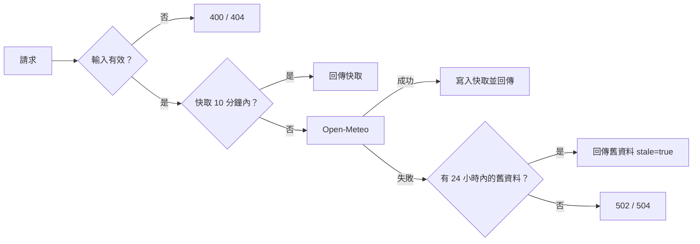
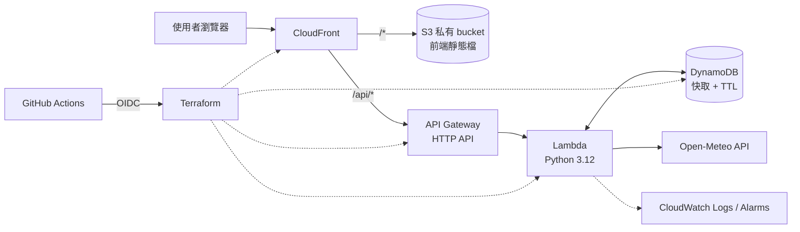

# WeatherCast Cloud API

> 後端 API 已部署在 AWS（ap-northeast-1），合併到 main 會由 GitHub Actions 自動部署。前端目前在本機執行。

查詢台灣 22 縣市目前天氣的 Serverless API。後端使用 Python，透過 Open-Meteo 取得氣象資料，部署在 AWS，所有雲端資源以 Terraform 管理，並用 GitHub Actions 自動測試與部署。

## API

| 路徑 | 說明 |
|---|---|
| `GET /api/health` | 健康檢查，回傳 `{"status":"ok"}` |
| `GET /api/cities` | 支援的 22 縣市清單 |
| `GET /api/weather?city=Tainan` | 目前天氣；`city` 接受中文（台／臺皆可）、英文或 ID |

成功（200）：

```json
{
  "city": { "id": "tainan", "name": "臺南市", "name_en": "Tainan" },
  "current": {
    "time": "2026-10-16T19:00",
    "temperature": 27.1,
    "apparent_temperature": 29.9,
    "humidity": 78,
    "precipitation": 0.2,
    "wind_speed": 9.4,
    "weather_code": 61,
    "description": "小雨"
  },
  "meta": { "source": "upstream", "stale": false, "fetched_at": 1792148400, "provider": "open-meteo" }
}
```

| `meta` 欄位 | 說明 |
|---|---|
| `source` | `upstream`：這次剛向 Open-Meteo 取得；`cache`：從 DynamoDB 快取取得 |
| `stale` | `true` 代表 Open-Meteo 暫時無法使用，回傳的是超過 10 分鐘的舊資料 |
| `fetched_at` | 資料從 Open-Meteo 取得的時間（Unix 秒），不是這次請求的時間 |

錯誤一律是 `{"error": "<代碼>", "message": "<說明>"}`，不會包含 traceback 或內部細節：

| 狀態碼 | `error` | 情況 |
|---|---|---|
| 400 | `missing_city` | 沒有 `city`，或只有空白 |
| 400 | `invalid_city` | `city` 超過 50 字元 |
| 404 | `city_not_found` | 不在 22 縣市內 |
| 404 | `not_found` | 路徑不存在 |
| 405 | `method_not_allowed` | 不是 GET |
| 502 | `upstream_error` | Open-Meteo 連線失敗、回傳 HTTP 錯誤或無效資料 |
| 504 | `upstream_timeout` | Open-Meteo 3 秒內沒有回應 |
| 500 | `internal_error` | 未預期錯誤；回應附 `request_id`，細節只寫進 log |

Open-Meteo 失敗時，如果快取裡有 24 小時內的資料，會回 200 和 `stale: true`，不會回 502／504。

## 快取

每個城市在 DynamoDB 存一筆資料，10 分鐘內的查詢直接回傳快取，不呼叫 Open-Meteo。資料表設計、TTL 與故障處理見 [docs/cache.md](docs/cache.md)。



DynamoDB 故障時只記 log，照樣查 Open-Meteo，使用者不受影響。

## 預定功能

- `GET /api/health`：服務健康檢查
- `GET /api/cities`：支援的縣市清單
- `GET /api/weather?city=Tainan`：查詢目前天氣（溫度、體感溫度、濕度、降雨量、風速、天氣代碼）
- DynamoDB 快取：減少重複呼叫外部 API；外部 API 失敗時回傳較舊的資料並標示
- React 前端：輸入或選擇縣市並顯示天氣

## 預定架構



| 元件 | 負責 |
|---|---|
| API Gateway HTTP API | 對外 HTTP 入口、路由、節流 |
| Lambda（Python 3.12） | 輸入驗證、查快取、呼叫 Open-Meteo、整理回應 |
| Open-Meteo | 第三方氣象資料（免 API key） |
| DynamoDB | 快取查詢結果，TTL 自動清除舊資料 |
| CloudWatch | 執行紀錄與錯誤告警 |
| Terraform | 建立與更新所有 AWS 資源 |
| GitHub Actions | PR 時執行測試，合併到 main 後自動部署 |

## 專案結構

```
backend/src/          Lambda 原始碼（handler → weather_service → weather_client）
scripts/              本機工具與 CI 用腳本（plan 檢查、冒煙測試）
frontend/             React + Vite 前端
tests/                pytest 單元測試（不連網路）
terraform/bootstrap/  一次性資源：Terraform state bucket、GitHub OIDC、部署用 IAM Role
terraform/main/       主要 AWS 資源
docs/                 設計文件與架構圖
```

## 本機開發

需要 Python 3.12 以上。

```bash
python3.12 -m venv .venv
source .venv/bin/activate          # Windows：.venv\Scripts\activate
pip install -r requirements-dev.txt

ruff check .                       # 程式風格與常見錯誤
pytest                             # 單元測試
pytest --cov                       # 單元測試 + 覆蓋率報告
```

單元測試不會連到 Open-Meteo，也不會連到 AWS：`tests/conftest.py` 把 `urlopen` 換成假的、用 moto 在記憶體裡模擬 DynamoDB，並擋掉所有對外連線。

不用部署也能直接呼叫 Lambda handler（`/weather` 會真的連到 Open-Meteo）。沒有設定 `CACHE_TABLE` 環境變數時不使用快取，所以不需要 AWS 帳號：

```bash
python scripts/invoke_local.py /api/health
python scripts/invoke_local.py /api/weather city=Tainan
python scripts/invoke_local.py /api/weather city=台南
python scripts/invoke_local.py /api/weather city=Tokyo     # 404
python scripts/invoke_local.py /api/weather                # 400
```

## 基礎設施

所有 AWS 資源都在 `terraform/` 用 Terraform 管理：Lambda（Python 3.12、arm64）、API Gateway HTTP API、DynamoDB、IAM、CloudWatch Logs。資源說明、依賴關係，以及 Terraform 和 CI/CD 如何分工，見 [docs/infrastructure.md](docs/infrastructure.md)。

不需要 AWS 帳號也能做的檢查：

```bash
cd terraform/main
terraform fmt -check -recursive ..
terraform init -backend=false
terraform validate
```

## 前端

`frontend/` 是 React + Vite 的單頁介面：輸入城市或從清單選擇，顯示目前天氣，並處理載入中、找不到城市、網路失敗、伺服器錯誤等狀態。背景會依天氣代碼和日夜顯示動態效果（晴、雲、雨、雷雨、雪、霧），支援「減少動態效果」設定。

```bash
cd frontend
npm ci
cp .env.example .env.local         # 設定 VITE_API_BASE_URL
npm run dev                        # http://localhost:5173
npm test
npm run build
```

結構、設計決策、測試，以及部署到 S3 + CloudFront（私有 bucket + OAC）的 Terraform 設計建議，見 [docs/frontend.md](docs/frontend.md)。

## 部署

從建立 AWS 帳號權限、Terraform plan 與 apply、線上測試、查看 CloudWatch Logs、排除錯誤，到清除資源的完整步驟，見 [docs/deployment.md](docs/deployment.md)。

部署後，每個 PR 由 GitHub Actions 跑測試與 Terraform 檢查，合併到 main 後用 OIDC 登入 AWS 自動部署並做冒煙測試，見 [docs/cicd.md](docs/cicd.md)。

## 開發進度

- [x] 技術方案設計
- [x] 專案骨架
- [x] 後端 MVP（/health、/weather）
- [x] 單元測試
- [x] DynamoDB 快取（資料表在 Terraform 階段建立）
- [x] Terraform
- [x] 部署手冊與實際部署（2026-10-19 上線）
- [x] GitHub Actions CI/CD（啟用步驟見 docs/cicd.md）
- [x] React 前端（本機可執行；S3 + CloudFront 部署為設計建議，見 docs/frontend.md）
