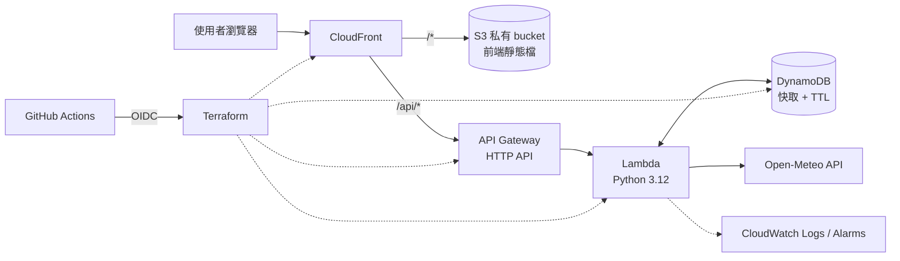

# WeatherCast Cloud API

> 開發中。目前只有專案骨架，尚未實作任何功能、也尚未部署。

查詢台灣 22 縣市目前天氣的 Serverless API。後端使用 Python，透過 Open-Meteo 取得氣象資料，部署在 AWS，所有雲端資源以 Terraform 管理，並用 GitHub Actions 自動測試與部署。

## 預定功能

- `GET /api/health`：服務健康檢查
- `GET /api/cities`：支援的縣市清單
- `GET /api/weather?city=Tainan`：查詢目前天氣（溫度、體感溫度、濕度、降雨量、風速、天氣代碼）
- DynamoDB 快取：減少重複呼叫外部 API；外部 API 失敗時回傳較舊的資料並標示
- React 前端：選擇縣市並顯示天氣

## 預定架構



| 元件 | 負責 |
|---|---|
| API Gateway HTTP API | 對外 HTTP 入口、路由、節流 |
| Lambda（Python 3.12） | 輸入驗證、查快取、呼叫 Open-Meteo、整理回應 |
| Open-Meteo | 第三方氣象資料（免 API key） |
| DynamoDB | 快取查詢結果，TTL 自動清除舊資料 |
| CloudWatch | 執行紀錄與錯誤告警 |
| Terraform | 建立與更新所有 AWS 資源 |
| GitHub Actions | PR 時執行測試，合併到 main 後自動部署 |

## 專案結構

```
backend/src/          Lambda 原始碼
tests/                pytest 單元測試
terraform/bootstrap/  一次性資源：Terraform state bucket、GitHub OIDC、部署用 IAM Role
terraform/main/       主要 AWS 資源
docs/                 設計文件與架構圖
```

## 本機開發

需要 Python 3.12 以上。

```bash
python3.12 -m venv .venv
source .venv/bin/activate          # Windows：.venv\Scripts\activate
pip install -r requirements-dev.txt

ruff check .                       # 程式風格與常見錯誤
pytest                             # 單元測試
```

## 開發進度

- [x] 技術方案設計
- [x] 專案骨架
- [ ] 後端 MVP（/health、/weather）
- [ ] 單元測試
- [ ] DynamoDB 快取
- [ ] Terraform
- [ ] GitHub Actions CI/CD
- [ ] React 前端
