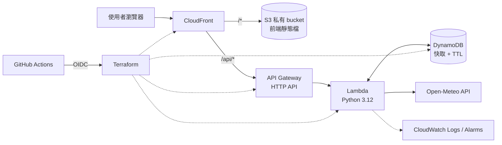

# WeatherCast Cloud API

> 開發中。後端 API 已可在本機執行，尚未部署到 AWS。

查詢台灣 22 縣市目前天氣的 Serverless API。後端使用 Python，透過 Open-Meteo 取得氣象資料，部署在 AWS，所有雲端資源以 Terraform 管理，並用 GitHub Actions 自動測試與部署。

## API

| 路徑 | 說明 |
|---|---|
| `GET /api/health` | 健康檢查，回傳 `{"status":"ok"}` |
| `GET /api/cities` | 支援的 22 縣市清單 |
| `GET /api/weather?city=Tainan` | 目前天氣；`city` 接受中文（台／臺皆可）、英文或 ID |

成功（200）：

```json
{
  "city": { "id": "tainan", "name": "臺南市", "name_en": "Tainan" },
  "current": {
    "time": "2026-10-16T19:00",
    "temperature": 27.1,
    "apparent_temperature": 29.9,
    "humidity": 78,
    "precipitation": 0.2,
    "wind_speed": 9.4,
    "weather_code": 61,
    "description": "小雨"
  },
  "meta": { "source": "upstream", "stale": false, "fetched_at": 1792148400, "provider": "open-meteo" }
}
```

錯誤一律是 `{"error": "<代碼>", "message": "<說明>"}`，不會包含 traceback 或內部細節：

| 狀態碼 | `error` | 情況 |
|---|---|---|
| 400 | `missing_city` | 沒有 `city`，或只有空白 |
| 400 | `invalid_city` | `city` 超過 50 字元 |
| 404 | `city_not_found` | 不在 22 縣市內 |
| 404 | `not_found` | 路徑不存在 |
| 405 | `method_not_allowed` | 不是 GET |
| 502 | `upstream_error` | Open-Meteo 連線失敗、回傳 HTTP 錯誤或無效資料 |
| 504 | `upstream_timeout` | Open-Meteo 3 秒內沒有回應 |
| 500 | `internal_error` | 未預期錯誤；回應附 `request_id`，細節只寫進 log |

## 預定功能

- `GET /api/health`：服務健康檢查
- `GET /api/cities`：支援的縣市清單
- `GET /api/weather?city=Tainan`：查詢目前天氣（溫度、體感溫度、濕度、降雨量、風速、天氣代碼）
- DynamoDB 快取：減少重複呼叫外部 API；外部 API 失敗時回傳較舊的資料並標示
- React 前端：選擇縣市並顯示天氣

## 預定架構



| 元件 | 負責 |
|---|---|
| API Gateway HTTP API | 對外 HTTP 入口、路由、節流 |
| Lambda（Python 3.12） | 輸入驗證、查快取、呼叫 Open-Meteo、整理回應 |
| Open-Meteo | 第三方氣象資料（免 API key） |
| DynamoDB | 快取查詢結果，TTL 自動清除舊資料 |
| CloudWatch | 執行紀錄與錯誤告警 |
| Terraform | 建立與更新所有 AWS 資源 |
| GitHub Actions | PR 時執行測試，合併到 main 後自動部署 |

## 專案結構

```
backend/src/          Lambda 原始碼（handler → weather_service → weather_client）
scripts/              本機工具
tests/                pytest 單元測試（不連網路）
terraform/bootstrap/  一次性資源：Terraform state bucket、GitHub OIDC、部署用 IAM Role
terraform/main/       主要 AWS 資源
docs/                 設計文件與架構圖
```

## 本機開發

需要 Python 3.12 以上。

```bash
python3.12 -m venv .venv
source .venv/bin/activate          # Windows：.venv\Scripts\activate
pip install -r requirements-dev.txt

ruff check .                       # 程式風格與常見錯誤
pytest                             # 單元測試
pytest --cov                       # 單元測試 + 覆蓋率報告
```

單元測試不會連到 Open-Meteo：`tests/conftest.py` 把 `urlopen` 換成假的，並擋掉所有對外連線。

不用部署也能直接呼叫 Lambda handler（`/weather` 會真的連到 Open-Meteo）：

```bash
python scripts/invoke_local.py /api/health
python scripts/invoke_local.py /api/weather city=Tainan
python scripts/invoke_local.py /api/weather city=台南
python scripts/invoke_local.py /api/weather city=Tokyo     # 404
python scripts/invoke_local.py /api/weather                # 400
```

## 開發進度

- [x] 技術方案設計
- [x] 專案骨架
- [x] 後端 MVP（/health、/weather）
- [x] 單元測試
- [ ] DynamoDB 快取
- [ ] Terraform
- [ ] GitHub Actions CI/CD
- [ ] React 前端
