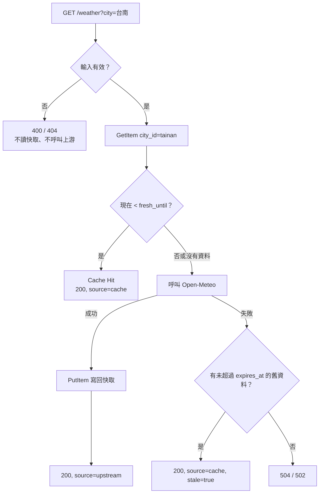

# DynamoDB 快取設計

## 目的

- 減少對 Open-Meteo 的呼叫：同一個城市 10 分鐘內只查一次。
- Open-Meteo 暫時故障時，仍然可以回傳最近一次的資料，並標示為舊資料。

## 資料表

| 屬性 | 型別 | 說明 |
|---|---|---|
| `city_id` | String，Partition Key | 正規化後的城市 ID，例如 `tainan` |
| `payload` | String（JSON） | 整理好的 `current` 區塊 |
| `fetched_at` | Number | 從 Open-Meteo 取得資料的時間（Unix 秒） |
| `fresh_until` | Number | `fetched_at + CACHE_FRESH_SECONDS` |
| `expires_at` | Number，TTL 屬性 | `fetched_at + CACHE_RETAIN_SECONDS` |

- **Partition Key 用 `city_id`**：唯一的查詢方式是「某個城市的天氣」，一次 `GetItem` 就能取得。存的是正規化後的 ID，所以「台南」「臺南市」「Tainan」都讀寫同一筆資料。
- **`payload` 存 JSON 字串**：boto3 不接受 `float`，必須轉成 `Decimal`。快取只需要整包存、整包取，存字串最單純。
- **On-Demand 計費**：流量小且不固定，沒有請求時不產生容量費用。

## 流程

## TTL

DynamoDB TTL 刪除不是即時的，通常在過期後幾天內才刪除，不保證時間。所以：

- 要不要重新呼叫 Open-Meteo，看程式自己比對的 `fresh_until`。
- 讀到已超過 `expires_at`、但 DynamoDB 還沒刪掉的資料，程式當作不存在。即使上游失敗，也不會回傳比保留期限更舊的資料。

## 快取故障時

快取只是加速手段，不是資料來源，所以採用 **fail-open**：DynamoDB 讀寫失敗（逾時、權限、資料表不存在、資料損壞）只記 error log，照樣呼叫 Open-Meteo 回應使用者。

- 代價：快取故障期間，每個請求都會呼叫 Open-Meteo。API Gateway 的節流設定會限制請求量，保護上游並控制費用。
- boto3 預設逾時是 60 秒。這裡設成連線 1 秒、讀取 1 秒，而且不重試。最壞情況是讀 2 秒、Open-Meteo 3 秒、寫 2 秒，仍在 Lambda 的 10 秒逾時內。

## 設定

| 環境變數 | 預設值 | 說明 |
|---|---|---|
| `CACHE_TABLE` | 無 | 資料表名稱；沒設定就停用快取 |
| `CACHE_FRESH_SECONDS` | `600` | 新鮮期 |
| `CACHE_RETAIN_SECONDS` | `86400` | 保留期，也是舊資料最多能回傳多久 |

快取在 Lambda 冷啟動時建立一次，之後重複使用。設定值不合法時，冷啟動直接失敗，錯誤會出現在 CloudWatch Logs。

Lambda 只需要 `dynamodb:GetItem` 和 `dynamodb:PutItem` 兩個權限，而且只限這張資料表。

## 相關 log

| `message` | 等級 | 意義 |
|---|---|---|
| `weather_ok` | info | 成功回應；`source` 欄位可以用來算快取命中率 |
| `serving_stale_cache` | warning | 上游失敗，回傳舊資料 |
| `cache_read_failed`、`cache_write_failed` | error | DynamoDB 故障，已改查上游 |
