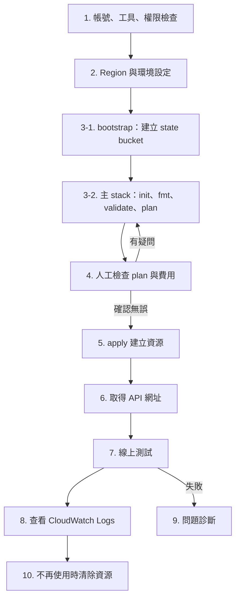

# 部署手冊：從零部署到 AWS

這份手冊從一個還沒建立任何資源的 AWS 帳號開始，照實際執行順序把 WeatherCast Cloud API 部署上線、測試、查看 log、排除問題，最後清除資源。

- 指令以 Windows PowerShell 為主，repo 位置以 `E:\weathercast-cloud` 為例。
- 所有資源都在 `ap-northeast-1`（東京）。
- 每一步都標示了驗證狀態，說明見下一節。

> **目前狀態：已部署（2026-10-19）。** 第 1 到 7 節已在真實 AWS 執行過一次（bootstrap 當時是 6 個資源，主 stack 13 個）。下方各節的 ⏳ 標示保留第七階段撰寫時的狀態。第八階段在 bootstrap 加了 GitHub Actions 用的 OIDC 與部署角色（+3 個資源），說明見 [cicd.md](cicd.md)。

## 驗證狀態

| 標示 | 意思 |
|---|---|
| ✅ 已驗證 | 實際執行過，並取得結果 |
| 🧪 模擬驗證 | 在沙盒用 moto 跑過，確認指令語法和 Terraform 流程正確，但不是真的 AWS。moto 是在本機模擬 AWS API 的工具 |
| ⏳ 尚待執行 | 需要真實的 AWS 帳號，還沒有人執行過 |

| 項目 | 狀態 | 依據 |
|---|---|---|
| 後端邏輯、錯誤碼、快取、打包設定 | ✅ | `pytest` 全部通過，覆蓋率 100%。第六階段沙盒和你的電腦都跑過 166 個；本階段加上手冊測試後，沙盒 175 個通過 |
| 手冊和程式碼一致 | ✅ | `tests/test_deployment_doc.py` 檢查手冊列出的資源、資源名稱、output、路由、變數預設值、zip 內容、事件檔，以及 PowerShell 參數有沒有加引號 |
| `terraform fmt`、`terraform validate` | ✅ | 你的電腦（Terraform 1.16.5）和沙盒都通過 |
| 本機工具版本 | ✅ | 你的電腦：Terraform 1.16.5、AWS CLI 2.38.1、Python 3.12.3 |
| bootstrap 的 plan | 🧪 | `Plan: 9 to add, 0 to change, 0 to destroy.`（第七階段的 6 個 S3 資源已在真實 AWS 建立 ✅；第八階段加的 3 個 IAM 資源只在沙盒驗證過） |
| 主 stack 用 S3 backend 初始化與 plan | 🧪 | `Plan: 13 to add, 0 to change, 0 to destroy.` |
| apply、讀取 output、再 plan 一次 | 🧪 | `13 added`；第二次 plan 顯示 `No changes` |
| 只改程式碼時的 plan | 🧪 | `Plan: 0 to add, 1 to change, 0 to destroy.`，變更的是 `source_code_hash` |
| plan -destroy、destroy、bootstrap 防刪 | 🧪 | `13 to destroy`、`13 destroyed`；bootstrap 回 `Instance cannot be destroyed` |
| 手冊裡的 AWS CLI 查詢指令 | 🧪 | 用 AWS CLI 2.38.1（和你電腦同版）對 moto 執行，輸出格式符合手冊 |
| 直接呼叫 Lambda 用的事件檔 | ✅ | 用 PowerShell 產生 JSON 檔，交給本機 handler 執行，`/api/health` 回 200 |
| AWS 帳號設定、SSO 登入、真實的 plan 與 apply、線上測試、CloudWatch、費用、清除 | ⏳ | 需要你的 AWS 帳號 |

模擬環境有幾個限制：

- moto 不支援 bucket policy 的 `Bool` 條件（`DenyInsecureTransport` 用到它），模擬時拿掉了 bucket policy。
- moto 的 S3 lifecycle 設定會一直卡在等待狀態，模擬時那一項建立失敗。
- 這兩點都是 moto 的限制，真實 AWS 會怎麼表現，要等你執行才知道。
- PowerShell 指令是在 Linux 上用 PowerShell 7.4 測的，參數模式設成 `Legacy`，模擬 Windows PowerShell 5.1 傳參數給外部程式的方式。不是在 Windows 上測的。

## 部署順序



---

## 1. 執行前檢查

### 1-1 本機工具 ✅

安裝 Terraform 和 AWS CLI 之後，要開一個新的 PowerShell 視窗，PATH 才會更新：

```powershell
cd E:\weathercast-cloud
terraform version                      # 需要 1.10 以上（S3 backend 的 use_lockfile 從 1.10 開始支援）
aws --version                          # 需要 AWS CLI v2（aws configure sso、aws logs tail 只有 v2 有）
git --version
.\.venv\Scripts\python.exe --version   # 3.12
```

### 1-2 程式是最新版，且測試通過 ⏳

```powershell
git switch main
git pull
git status                             # 應該顯示 nothing to commit, working tree clean
.\.venv\Scripts\python.exe -m pytest -q
```

Terraform 打包的是你本機 `backend/src` 的內容。有未提交的修改或測試沒過，就會把沒經過審查的程式部署上去。

如果還沒有 `.venv`，先建立：

```powershell
py -3.12 -m venv .venv
.\.venv\Scripts\python.exe -m pip install -r requirements-dev.txt
```

### 1-3 AWS 帳號與登入方式（只做一次）⏳

不要用 root 執行 Terraform，也不要建立長期有效的 Access Key。建議用 IAM Identity Center（舊名 AWS SSO）登入。它每次發的是幾小時後失效的臨時憑證，電腦上不會留下長期金鑰。

先用 root 登入 AWS 主控台，完成下面幾步。主控台的畫面可能和這裡寫的略有不同。

1. **幫 root 開 MFA**：右上角帳號名稱 → Security credentials → Assign MFA device。
2. **建立預算提醒**：Billing and Cost Management → Budgets → Create budget。
   - 選 Monthly cost budget 範本，金額例如 USD 5，填你的 email。
   - 預算只會寄信提醒，不會自動停止服務。
   - 用 root 做這一步，是因為 IAM 身分預設看不到帳單頁面。
3. **啟用 IAM Identity Center**：右上角 Region 先切到 Asia Pacific (Tokyo)，再搜尋 IAM Identity Center → Enable。單一帳號會一併建立 AWS Organizations，兩者都不收費。
4. **建立使用者**：Users → Add user，填使用者名稱和 email，再依照收到的信件設定密碼和 MFA。
5. **建立 permission set**：Permission sets → Create permission set → Predefined permission set → `AdministratorAccess`。
6. **指派**：AWS accounts → 勾選你的帳號 → Assign users or groups → 選剛建立的使用者和 `AdministratorAccess`。
7. **記下登入網址**：在 IAM Identity Center 的 Dashboard 記下 **AWS access portal URL**，格式像 `https://d-xxxxxxxxxx.awsapps.com/start`。

做完之後就不再用 root。

**為什麼部署者用 `AdministratorAccess`，不給更小的權限？**

- **PowerUserAccess 不夠用**：部署要建立 IAM Role 和 policy，包括 Lambda 的執行角色，以及第八階段 GitHub Actions 的部署角色。AWS 建議開發者使用的 `PowerUserAccess` 不允許建立 IAM Role，Terraform 會失敗。
- **縮小權限的效果有限**：一個身分如果能建立 IAM Role，又能決定 Role 的 policy 和信任對象，它就能替自己做出一個管理員角色。所以給部署者「PowerUser 加上 IAM 寫入」，安全上和直接給管理員差不多。
- **保護重點**：不用 root、開 MFA、只用臨時憑證、電腦上不放長期金鑰。
- **Least Privilege 落實在機器身分上**：Lambda 角色只能對一張表做 `GetItem`、`PutItem`，以及寫自己的 log。第八階段的 CI 角色也只會拿到部署需要的權限。

### 1-4 設定 AWS CLI profile ⏳

```powershell
aws configure sso
```

依序回答：

| 提示 | 填入 |
|---|---|
| SSO session name | `weathercast` |
| SSO start URL | 1-3 記下的 AWS access portal URL |
| SSO region | `ap-northeast-1`（Identity Center 所在的 Region） |
| SSO registration scopes | 直接按 Enter，使用預設的 `sso:account:access` |
| 瀏覽器自動開啟 | 登入後按允許 |
| 選帳號、選角色 | 只有一個時會自動選；角色是 `AdministratorAccess` |
| Default client Region | `ap-northeast-1` |
| CLI default output format | `json` |
| Profile name | `weathercast` |

設定寫在 `%USERPROFILE%\.aws\config`，裡面沒有金鑰；臨時憑證快取在 `%USERPROFILE%\.aws\sso\cache`。兩者都在 repo 外面，不會被 commit。

### 1-5 確認身分與權限 ⏳

```powershell
$env:AWS_PROFILE = "weathercast"
aws sso login                          # 憑證過期時再執行一次
aws sts get-caller-identity
```

預期的 `Arn`：

```text
arn:aws:sts::123456789012:assumed-role/AWSReservedSSO_AdministratorAccess_xxxxxxxx/你的使用者名稱
```

- 如果結尾是 `:root`，代表你正在用 root。先停下來，回到 1-3。
- 確認 `Account` 是你預期的帳號 ID。

接著確認權限。下面都是唯讀查詢，不會建立任何東西，也不會產生費用。四個指令都沒有出現 `AccessDenied` 就可以繼續：

```powershell
aws lambda list-functions --max-items 1 --query "length(Functions)"
aws dynamodb list-tables --max-items 1 --query "length(TableNames)"
aws iam list-roles --max-items 1 --query "length(Roles)"
aws apigatewayv2 get-apis --query "length(Items)"
```

### 1-6 確認資源名稱沒有被占用 ⏳

Terraform 會用固定的名稱建立資源。帳號裡如果已經有同名資源，apply 會在中途失敗。

```powershell
aws lambda get-function --function-name weathercast-api
aws dynamodb describe-table --table-name weathercast-cache
aws iam get-role --role-name weathercast-lambda
aws apigatewayv2 get-apis --query "Items[?Name=='weathercast-api'].ApiId"
aws logs describe-log-groups --log-group-name-prefix /aws/lambda/weathercast --query "logGroups[].logGroupName"
aws logs describe-log-groups --log-group-name-prefix /aws/apigateway/weathercast --query "logGroups[].logGroupName"
```

名稱可用時，預期的結果是（🧪）：

| 指令 | 預期 |
|---|---|
| `lambda get-function` | `ResourceNotFoundException` |
| `dynamodb describe-table` | `ResourceNotFoundException` |
| `iam get-role` | `NoSuchEntity` |
| `apigatewayv2 get-apis` | `[]` |
| 兩個 `logs describe-log-groups` | `[]` |

## 2. Region、變數與環境設定

### 2-1 Region

所有資源都在 `ap-northeast-1`（東京），設定分散在這幾個地方：

| 位置 | 值 |
|---|---|
| `terraform/bootstrap/variables.tf` 的 `region` | `ap-northeast-1` |
| `terraform/main/variables.tf` 的 `region` | `ap-northeast-1` |
| `terraform/main/versions.tf` 的 backend `region` | `ap-northeast-1`。backend 區塊不能用變數，所以是寫死的 |
| AWS CLI profile 的 region | `ap-northeast-1`，在 1-4 設定 |

Terraform 的 provider 明確使用 `var.region`，所以不受 `AWS_REGION` 環境變數影響。AWS CLI 則是用 profile 的 region。兩邊不一致時，`aws logs tail` 等指令會到別的 Region 去找，結果什麼都找不到。

```powershell
aws configure get region               # 應該是 ap-northeast-1
```

如果要改用其他 Region，兩個 stack 都要加上 `"-var=region=..."`，主 stack 的 init 還要加 `"-backend-config=region=..."`。這份手冊不採用這個做法。

### 2-2 Terraform 變數

所有變數都有預設值，**不需要建立 tfvars 檔**。主 stack 的變數：

| 變數 | 預設值 | 用途 |
|---|---|---|
| `project_name` | `weathercast` | 所有資源名稱的前綴 |
| `lambda_memory_mb` | `256` | Lambda 記憶體 |
| `lambda_timeout_seconds` | `10` | Lambda 逾時；API Gateway 整合逾時會自動設成它加 1 秒 |
| `log_retention_days` | `14` | 兩個 log group 的保留天數 |
| `cache_fresh_seconds` | `600` | 快取新鮮期 |
| `cache_retain_seconds` | `86400` | 快取保留期，也是 TTL |
| `api_throttle_rate_limit` | `10` | 每秒平均請求上限 |
| `api_throttle_burst_limit` | `20` | 瞬間請求上限 |
| `cors_allow_origins` | `["http://localhost:5173"]` | 允許跨網域呼叫的來源 |

如果只想暫時改一個值，可以在 plan 時加參數，例如 `terraform plan "-var=log_retention_days=7" "-out=main.tfplan"`，但每次 plan 都要帶。要長期修改，請直接改 `variables.tf` 的預設值並發 PR。`*.tfvars` 被 `.gitignore` 排除，其他電腦和 CI 都看不到。

### 2-3 每次開新的 PowerShell 視窗

```powershell
cd E:\weathercast-cloud
$env:AWS_PROFILE = "weathercast"                           # AWS CLI 和 Terraform 都用這個 profile
[Console]::OutputEncoding = [System.Text.Encoding]::UTF8   # 讓 curl.exe 印出的中文不會變亂碼
aws sso login                                              # 憑證過期時才需要
```

需要設定的只有 profile 名稱，沒有任何金鑰或密碼。

### 2-4 PowerShell 的陷阱

- **含 `.` 的參數會被拆開。** `-out=main.tfplan`、`-chdir=..\bootstrap` 這類參數在 PowerShell 會被拆成兩段，Terraform 回 `Too many command line arguments`。凡是 `-參數=值` 的寫法，一律整個加上雙引號，例如 `"-out=main.tfplan"`。（🧪 實測）
- **`curl` 不是 curl。** 在 Windows PowerShell 5.1，`curl` 是 `Invoke-WebRequest` 的別名，要打 `curl.exe`。
- **大括號要加單引號。** AWS CLI 的 shorthand 寫法含大括號時要加單引號，例如 `'city_id={S=tainan}'`，不然 PowerShell 會把 `{...}` 當成程式區塊。（🧪 實測）
- **JSON 不要直接當參數。** 含雙引號的 JSON 直接傳給 `aws` 時，Windows PowerShell 5.1 會吃掉裡面的雙引號。請先寫成檔案，再用 `file://` 或 `fileb://` 傳入。（🧪 實測）

## 3. Terraform 初始化、格式檢查、驗證與 Plan

### 3-1 bootstrap：建立存放 state 的 S3 bucket（只做一次）

主 stack 的 state 要放在 S3，所以先用 bootstrap 建立那個 bucket。bootstrap 本身的 state 存在本機。

bootstrap 也建立 GitHub Actions 部署用的 OIDC 身分提供者和 IAM 角色（`github_oidc.tf`，說明見 [cicd.md](cicd.md)）。

```powershell
cd E:\weathercast-cloud\terraform\bootstrap
terraform init
terraform fmt -check -recursive ..     # 沒有輸出就代表格式正確
terraform validate
terraform plan "-out=bootstrap.tfplan"
```

預期結果是 `Plan: 9 to add, 0 to change, 0 to destroy.`（🧪）。如果 bootstrap 已經 apply 過第七階段的版本，只會看到下面最後 3 個 IAM 相關資源：`Plan: 3 to add, 0 to change, 0 to destroy.`。列出即將建立的資源：

```powershell
terraform show -no-color bootstrap.tfplan | Select-String "will be created|will be updated|must be replaced|will be destroyed" | ForEach-Object Line
```

預期會有這 9 行，全部都是 `will be created`（🧪）：

```text
  # aws_s3_bucket.tf_state will be created
  # aws_s3_bucket_lifecycle_configuration.tf_state will be created
  # aws_s3_bucket_policy.tf_state will be created
  # aws_s3_bucket_public_access_block.tf_state will be created
  # aws_s3_bucket_server_side_encryption_configuration.tf_state will be created
  # aws_s3_bucket_versioning.tf_state will be created
  # aws_iam_openid_connect_provider.github will be created
  # aws_iam_role.github_deploy will be created
  # aws_iam_role_policy.github_deploy will be created
```

另外確認 plan 最後的 `state_bucket` 是 `weathercast-tfstate-<你的帳號 ID>`，`github_deploy_role_arn` 是 `arn:aws:iam::<你的帳號 ID>:role/weathercast-github-deploy`。確認無誤後執行：

```powershell
terraform apply bootstrap.tfplan
terraform output -raw state_bucket
```

- **不會再問 yes。** `terraform apply <plan 檔>` 會直接照 plan 執行，所以一定要先看過 plan。
- **保留本機的 state 檔。** bootstrap 的 state 在 `terraform\bootstrap\terraform.tfstate`，已被 `.gitignore` 排除。之後要修改或刪除這個 bucket 都需要它。弄丟了 bucket 還在，但要用 `terraform import` 才能重新納管。

### 3-2 主 stack ⏳

```powershell
cd ..\main
$bucket = terraform "-chdir=..\bootstrap" output -raw state_bucket
$bucket                                # 確認是 weathercast-tfstate-<帳號 ID>
terraform init "-backend-config=bucket=$bucket"
terraform fmt -check -recursive ..
terraform validate
terraform plan "-out=main.tfplan"
```

| 指令 | 預期 |
|---|---|
| `init` | `Successfully configured the backend "s3"!` 和 `Terraform has been successfully initialized!`（🧪） |
| `fmt -check` | 沒有輸出。如果列出檔名，執行 `terraform fmt -recursive ..`，修正後再 commit |
| `validate` | `Success! The configuration is valid.`（✅） |
| `plan` | `Plan: 13 to add, 0 to change, 0 to destroy.`（🧪），同時產生 `build\lambda.zip` |

- **為什麼 init 要帶 bucket？** 因為 backend 的 bucket 名稱含帳號 ID，沒有寫死在程式碼裡，要在 init 時用 `-backend-config` 帶入。
- **init 問要不要複製 state？** 如果出現 `Do you want to copy existing state to the new backend?`，代表 `terraform\main` 裡有舊的本機 state。先停下來確認，正常情況不會出現這個問題。

## 4. 人工檢查 Plan

### 4-1 資源數量與動作

```powershell
terraform show -no-color main.tfplan | Select-String "will be created|will be updated|must be replaced|will be destroyed" | ForEach-Object Line
```

第一次部署時，預期有 13 行，而且全部是 `will be created`（🧪）：

```text
  # aws_apigatewayv2_api.http will be created
  # aws_apigatewayv2_integration.lambda will be created
  # aws_apigatewayv2_route.routes["GET /api/cities"] will be created
  # aws_apigatewayv2_route.routes["GET /api/health"] will be created
  # aws_apigatewayv2_route.routes["GET /api/weather"] will be created
  # aws_apigatewayv2_stage.default will be created
  # aws_cloudwatch_log_group.api_access will be created
  # aws_cloudwatch_log_group.lambda will be created
  # aws_dynamodb_table.cache will be created
  # aws_iam_role.lambda will be created
  # aws_iam_role_policy.lambda will be created
  # aws_lambda_function.api will be created
  # aws_lambda_permission.apigw will be created
```

- **出現 `must be replaced` 或 `will be destroyed`**：第一次部署不應該有這兩種，代表 state 裡有你沒預期的東西，先停下來。
- **出現 `data.aws_iam_policy_document.lambda will be read during apply`**：這是正常的。policy 要引用資料表的 ARN，而資料表還沒建立。

想用表格方式看每個資源的動作，可以解析 plan 的 JSON（🧪）：

```powershell
(terraform show -json main.tfplan | ConvertFrom-Json).resource_changes |
  Where-Object mode -eq "managed" |
  ForEach-Object { "{0,-8} {1}" -f ($_.change.actions -join ","), $_.address }
```

### 4-2 關鍵設定

只挑出要檢查的欄位（🧪）：

```powershell
terraform show -no-color main.tfplan | Select-String '^\s+\+ (runtime|handler|memory_size|timeout|billing_mode|hash_key|retention_in_days|throttling_\w+)\s+=|"arm64"|CACHE_|localhost|attribute_name' | ForEach-Object Line
```

要看完整的 plan，可以存成檔案用記事本打開：

```powershell
terraform show -no-color main.tfplan | Out-File -Encoding utf8 "$env:TEMP\main-plan.txt"
notepad "$env:TEMP\main-plan.txt"
```

| 資源 | 欄位 | 預期值 | 為什麼要看 |
|---|---|---|---|
| `aws_lambda_function.api` | `runtime` / `architectures` | `python3.12` / `arm64` | 和本機測試的 Python 版本一致；arm64 比較便宜 |
| | `handler` | `handler.lambda_handler` | 寫錯會造成 Handler 錯誤（見 9-1） |
| | `memory_size` / `timeout` | `256` / `10` | 逾時要大於 Open-Meteo 的 3 秒加上 DynamoDB 讀寫時間 |
| | `CACHE_TABLE` 等環境變數 | `weathercast-cache`、`600`、`86400` | 快取設定錯誤會讓冷啟動直接失敗 |
| `aws_dynamodb_table.cache` | `billing_mode` | `PAY_PER_REQUEST` | 用多少付多少；沒有請求就沒有容量費 |
| | `hash_key` / TTL `attribute_name` | `city_id` / `expires_at` | 和程式讀寫的欄位一致 |
| 兩個 `aws_cloudwatch_log_group` | `retention_in_days` | `14` | 不設定的話 log 會永久保存並持續收費 |
| `aws_apigatewayv2_stage.default` | `throttling_rate_limit` / `throttling_burst_limit` | `10` / `20` | 費用上限的防線，超過的請求直接回 429 |
| `aws_apigatewayv2_api.http` | `allow_origins` | 只有 `http://localhost:5173` | 沒有開放 `*` |
| `aws_iam_role_policy.lambda` | `policy` | `(known after apply)` | 內容要等資料表建立後才知道。請直接看 `terraform/main/iam.tf`；apply 之後再用 9-2 的指令確認 |

### 4-3 可能的費用

**這次部署沒有按小時計費的資源**：沒有 EC2、NAT Gateway、RDS、Load Balancer、Provisioned Concurrency，也沒有自訂的 KMS 金鑰。所有費用都依實際用量計算。

| 資源 | 計費方式 | 備註 |
|---|---|---|
| API Gateway HTTP API | 每百萬次請求 | 超過節流的請求直接回 429，不會執行 Lambda |
| Lambda | 請求次數，加上執行時間乘以記憶體 | arm64 的單價比 x86 低；Lambda 每月有固定的免費額度 |
| DynamoDB On-Demand | 每次讀寫，加上儲存量 | 最多 22 筆資料，每筆約幾百 bytes |
| CloudWatch Logs | 寫入量（GB），加上儲存量 | 保留 14 天；Logs Insights 依掃描量計費 |
| S3（state bucket） | 儲存量和請求數 | state 只有幾 KB，舊版本保留 90 天 |
| IAM、API 設定、log group 本身 | 免費 | |

- **展示用的流量**：每天幾十到幾百次請求，預期每月遠低於 1 美元。這是估算，沒有實測過，也可能被你帳號的免費額度或 credits 抵掉。
- **最壞情況**：有人一直打到節流上限，每秒 10 次。一個月最多約 2,600 萬次請求（10 × 86,400 × 30），費用粗估在數十美元等級。實際金額請用 [AWS Pricing Calculator](https://calculator.aws/) 依這個請求量估算。
- **防線**：1-3 建立的預算提醒會在超過金額時寄信。想把上限壓得更低，可以把 `api_throttle_rate_limit` 調小。

## 5. 建立 AWS 資源 ⏳

確認 plan 之後：

```powershell
terraform apply main.tfplan
```

- **不會再問 yes**，會直接照 `main.tfplan` 執行。
- **預期結果**：`Apply complete! Resources: 13 added, 0 changed, 0 destroyed.`（🧪），最後印出 output。
- **出現 `Saved plan is stale`**：代表 plan 之後 state 變過了。重新執行 `terraform plan "-out=main.tfplan"`，檢查後再 apply。
- **中途失敗時**：已建立的資源都記在 state 裡。修正原因後重新 plan，這次只會列出還沒建立的部分，再 apply。不要到主控台手動刪除資源。
- **IAM 尚未生效的錯誤**：IAM 剛建立的角色要過一下子才會在各服務生效，偶爾會看到 `The role defined for the function cannot be assumed by Lambda`。AWS provider 會自動重試；如果還是失敗，重新 plan 再 apply 即可。

建立完成後，再 plan 一次確認狀態一致：

```powershell
terraform plan                         # 預期：No changes. Your infrastructure matches the configuration.（🧪）
```

這一步同時證明打包的 zip 是穩定的。如果每次 plan 都說 Lambda 要更新，代表 zip 內容不穩定，例如換行字元不同。

## 6. 取得 API Gateway URL ⏳

```powershell
terraform output                       # 列出全部 output
$api = terraform output -raw api_base_url
$api                                   # https://<api-id>.execute-api.ap-northeast-1.amazonaws.com
```

`health_url`、`weather_example_url` 這兩個 output 是組好路徑的完整網址，可以直接貼到瀏覽器。

不在 `terraform\main` 資料夾時，也可以用 AWS CLI 或主控台查詢：

```powershell
aws apigatewayv2 get-apis --query "Items[?Name=='weathercast-api'].ApiEndpoint" --output text
```

主控台的路徑是 API Gateway → APIs → `weathercast-api` → Invoke URL。

- **網址不含 stage 名稱**：使用的是 `$default` stage，所以網址後面直接接路徑。
- **網址會變**：`<api-id>` 是建立時隨機產生的。API 被刪除後重建，網址就會改變。

## 7. 測試線上 API ⏳

**路徑要加 `/api` 前綴。** 需求裡的 `GET /health` 和 `GET /weather?city=Tainan`，在線上是 `/api/health` 和 `/api/weather?city=Tainan`。API Gateway 只開放三條 `/api/...` 路由，因為之後 CloudFront 會把 `/api/*` 轉給 API。沒有前綴的 `/health` 會得到 API Gateway 自己回的 404。

```powershell
curl.exe -s -i "$api/api/health"
curl.exe -s -i "$api/api/weather?city=Tainan"
curl.exe -s -i "$api/api/weather?city=Tainan"   # 10 分鐘內再查一次
curl.exe -s -i "$api/api/weather?city=Tokyo"
curl.exe -s -i "$api/api/weather"
curl.exe -s -i "$api/health"
```

| 請求 | 預期狀態碼 | 回應內容重點 |
|---|---|---|
| `/api/health` | 200 | `{"status": "ok"}` |
| `/api/weather?city=Tainan`（第一次） | 200 | `city.id` 是 `tainan`；`meta.source` 是 `upstream`；`meta.stale` 是 `false` |
| 同一個請求，10 分鐘內再查 | 200 | `meta.source` 變成 `cache`，代表 DynamoDB 快取有作用 |
| `/api/weather?city=Tokyo` | 404 | `"error": "city_not_found"` |
| `/api/weather` | 400 | `"error": "missing_city"` |
| `/health`（沒有 `/api`） | 404 | `{"message":"Not Found"}`，這是 API Gateway 回的，Lambda 沒有被呼叫 |

用 PowerShell 物件查看欄位會比較清楚。`Invoke-RestMethod` 遇到 4xx、5xx 會丟出例外，所以錯誤情況的測試請用上面的 `curl.exe`。

```powershell
$r = Invoke-RestMethod "$api/api/weather?city=Tainan"
$r.current                             # 溫度、體感溫度、濕度、降雨量、風速、天氣描述
$r.meta                                # source、stale、fetched_at、provider
```

確認快取真的寫進 DynamoDB：

```powershell
aws dynamodb get-item --table-name weathercast-cache --key 'city_id={S=tainan}' --query "Item.{fetched_at:fetched_at.N,fresh_until:fresh_until.N,expires_at:expires_at.N}"
```

`fresh_until` 應該等於 `fetched_at` 加 600，`expires_at` 應該等於 `fetched_at` 加 86400。

確認 CORS 只開放本機前端：

```powershell
curl.exe -s -i -H "Origin: http://localhost:5173" "$api/api/health"   # 預期有 access-control-allow-origin: http://localhost:5173
curl.exe -s -i -H "Origin: https://example.com" "$api/api/health"     # 預期沒有 access-control-allow-origin
```

## 8. 查看 CloudWatch Logs ⏳

| Log group | 內容 |
|---|---|
| `/aws/lambda/weathercast-api` | Lambda 的 `START`、`END`、`REPORT`（執行時間、記憶體用量，冷啟動時還有 `Init Duration`），以及程式印出的 JSON log：`weather_ok`、`upstream_error`、`cache_read_failed`、`unhandled_exception` 等 |
| `/aws/apigateway/weathercast-api` | API Gateway 存取紀錄，每個請求一行 JSON：`requestId`、`ip`、`routeKey`、`status`、`latencyMs`、`integrationError`、`lambdaStatus` |

### 8-1 用 AWS CLI 查看

```powershell
aws logs tail /aws/lambda/weathercast-api --since 15m
aws logs tail /aws/lambda/weathercast-api --follow           # 持續顯示新的 log，按 Ctrl+C 結束
aws logs tail /aws/apigateway/weathercast-api --since 15m

# 只看特定事件（過濾在 PowerShell 這端做，避開 5.1 的引號問題）
aws logs tail /aws/lambda/weathercast-api --since 1h | Select-String "upstream_|cache_read_failed|cache_write_failed|unhandled_exception" | ForEach-Object Line
```

請求送出後，log 可能要過幾秒才查得到。

### 8-2 用 Logs Insights 查詢

在主控台開啟 CloudWatch → Logs Insights，選 log group 和時間範圍，再貼上查詢。程式的 log 是一行一個 JSON，Logs Insights 會自動把欄位解析出來。Logs Insights 依掃描的資料量計費，這個專案的 log 很少，費用可以忽略。

最近的程式 log（`/aws/lambda/weathercast-api`）：

```text
fields @timestamp, level, message, city, source, stale, detail
| filter ispresent(level)
| sort @timestamp desc
| limit 50
```

快取命中比例：

```text
filter message = "weather_ok"
| stats count() as requests by source, stale
```

警告和錯誤：

```text
fields @timestamp, level, message, city, request_id, detail, error
| filter level in ["warning", "error"]
| sort @timestamp desc
```

執行時間、記憶體用量和冷啟動：

```text
filter @type = "REPORT"
| stats count() as invocations, avg(@duration) as avg_ms, max(@duration) as max_ms, max(@maxMemoryUsed / 1000 / 1000) as max_memory_mb, count(@initDuration) as cold_starts by bin(1h)
```

API Gateway 的 5xx（`/aws/apigateway/weathercast-api`）：

```text
fields @timestamp, routeKey, status, lambdaStatus, integrationError, latencyMs
| filter status like /^5/
| sort @timestamp desc
```

## 9. 問題診斷 ⏳

先從回應內容判斷錯誤是誰產生的：

| 回應內容 | 誰產生的 | 先看哪裡 |
|---|---|---|
| `{"error": "...", "message": "..."}` | 我們的 Lambda 程式 | 狀態碼和 `error` 代碼的意思見 README；細節在 Lambda log |
| `{"message":"Not Found"}` | API Gateway（沒有這條路由） | 路徑是不是少了 `/api` |
| `{"message":"Internal Server Error"}` | API Gateway（呼叫 Lambda 失敗，或 Lambda 回應無效） | 存取紀錄的 `integrationError`，以及 Lambda log |
| `{"message":"Too Many Requests"}`（429） | API Gateway 節流 | 降低請求頻率，或調整節流設定 |

存取紀錄裡的三個欄位可以把問題切開：

- `status`：回給使用者的狀態碼。
- `lambdaStatus`：我們程式回傳的狀態碼。Lambda 沒有回傳有效回應時，這裡不會有數字。
- `integrationError`：API Gateway 呼叫 Lambda 時遇到的錯誤訊息。

```powershell
aws logs tail /aws/apigateway/weathercast-api --since 30m | Select-String '"status":"5' | ForEach-Object Line
```

### 9-1 Lambda Handler 錯誤

**症狀**：連 `/api/health` 都回 `{"message":"Internal Server Error"}`，Lambda log 出現下面其中一種：

| Lambda log | 原因 |
|---|---|
| `Runtime.ImportModuleError: Unable to import module 'handler'` | zip 最上層沒有 `handler.py`；或程式 import 了 zip 裡沒有的套件 |
| `Runtime.HandlerNotFound` | `handler` 設定和程式裡的函式名稱對不上 |
| 冷啟動時出現 `ValueError: CACHE_FRESH_SECONDS ...` | 快取環境變數的值無效。程式在冷啟動時就檢查，所以會直接失敗 |
| `Task timed out after 10.xx seconds` | 執行超過 Lambda 逾時 |

請求處理過程中的例外，都會被我們的 `lambda_handler` 攔下，回傳 500 `{"error": "internal_error", "request_id": "..."}`。這是我們程式的回應，不屬於 Handler 錯誤。用 `request_id` 可以在 Lambda log 找到對應的 `unhandled_exception` 和完整 traceback。

**診斷步驟：**

```powershell
# 1. 找出錯誤訊息
aws logs tail /aws/lambda/weathercast-api --since 30m | Select-String "Error|Task timed out|unhandled_exception" | ForEach-Object Line

# 2. 確認 Lambda 的設定
aws lambda get-function-configuration --function-name weathercast-api --query "{Handler:Handler,Runtime:Runtime,Arch:Architectures,Timeout:Timeout,Env:Environment.Variables,LastUpdate:LastUpdateStatus}"

# 3. 確認 zip 內容（在 terraform\main 執行）
Add-Type -AssemblyName System.IO.Compression.FileSystem
$zip = [System.IO.Compression.ZipFile]::OpenRead((Resolve-Path .\build\lambda.zip).Path)
$zip.Entries.FullName
$zip.Dispose()
```

第 3 步預期列出 6 個檔案，而且都在最上層，沒有多一層資料夾（🧪）：`cities.py`、`handler.py`、`logger.py`、`weather_cache.py`、`weather_client.py`、`weather_service.py`。

**直接呼叫 Lambda，跳過 API Gateway。** 如果直接呼叫正常、透過網址卻失敗，問題就出在 API Gateway 和 Lambda 之間（見 9-3）。

```powershell
@'
{"rawPath": "/api/health", "requestContext": {"http": {"method": "GET"}}}
'@ | Set-Content -Encoding ascii "$env:TEMP\event-health.json"

aws lambda invoke --function-name weathercast-api --payload "fileb://$env:TEMP\event-health.json" "$env:TEMP\out.json"
Get-Content "$env:TEMP\out.json"
```

| 結果 | 意思 |
|---|---|
| `out.json` 是 `{"statusCode": 200, ... "body": "{\"status\": \"ok\"}"}` | Lambda 正常 |
| 指令輸出含 `"FunctionError": "Unhandled"`，`out.json` 有 `errorType` | Lambda 本身出錯，`errorType` 和 `errorMessage` 就是原因 |

事件檔的內容和 API Gateway 傳給 Lambda 的格式（payload 2.0）一致，只保留程式會讀的欄位。這份檔案已在本機交給 handler 驗證過，會回 200（✅）。

**修正方式：**

- `ImportModuleError`：`tests/test_packaging.py` 會檢查後端只 import 標準函式庫和 boto3。先確認測試通過，再重新 plan 並 apply。
- `HandlerNotFound`：`terraform/main/lambda.tf` 的 `handler` 必須是 `handler.lambda_handler`，這一點也有測試檢查。
- 冷啟動的 `ValueError`：環境變數來自 Terraform 變數。修正變數後重新 plan 並 apply。
- 逾時：先看 `REPORT` 行的 `Duration`。Open-Meteo 有 3 秒逾時，DynamoDB 的連線和讀取各 1 秒、不重試，正常情況會在 10 秒內回 504 或 200。如果真的跑到 10 秒，請在 Lambda log 找卡住的位置。

### 9-2 IAM AccessDenied

AccessDenied 可能發生在三個地方，處理方式不同。

**(a) 執行 Terraform 或 AWS CLI 時**：代表你的身分權限不足，訊息類似 `User: arn:aws:sts::...:assumed-role/AWSReservedSSO_.../你的名稱 is not authorized to perform: iam:CreateRole`。

```powershell
$env:AWS_PROFILE                       # 應該是 weathercast
aws sts get-caller-identity --query Arn --output text
```

| 狀況 | 處理 |
|---|---|
| ARN 不是 `AWSReservedSSO_AdministratorAccess_...` | profile 用錯了，重新設定 `$env:AWS_PROFILE` |
| 出現 `ExpiredToken`、`Token has expired` 或其他 SSO 錯誤 | 執行 `aws sso login` |
| permission set 是 `PowerUserAccess` | 它不能建立 IAM Role，改用 `AdministratorAccess`（原因見 1-3） |

**(b) Lambda 執行時**：代表 Lambda 角色的權限不足。

我們的設計是 DynamoDB 出錯時照樣回應（fail-open）。所以 API **仍然回 200**，只是 `meta.source` 永遠是 `upstream`，快取從不命中，Lambda log 會出現含 `AccessDeniedException` 的 `cache_read_failed` 或 `cache_write_failed`。

```powershell
aws logs tail /aws/lambda/weathercast-api --since 1h | Select-String "cache_read_failed|cache_write_failed" | ForEach-Object Line
aws iam get-role-policy --role-name weathercast-lambda --policy-name weathercast-lambda --query PolicyDocument
aws lambda get-function-configuration --function-name weathercast-api --query "{Role:Role,Table:Environment.Variables.CACHE_TABLE}"
```

預期的 policy 有兩段（🧪）：

- `CacheReadWrite`：`dynamodb:GetItem`、`dynamodb:PutItem`，Resource 是 `...:table/weathercast-cache`。
- `WriteOwnLogs`：`logs:CreateLogStream`、`logs:PutLogEvents`，Resource 是 `...:log-group:/aws/lambda/weathercast-api:*`。

接著確認兩件事：policy 裡的表名和 `CACHE_TABLE` 一致；`Role` 的結尾是 `role/weathercast-lambda`。

如果是 `WriteOwnLogs` 有問題，Lambda 就寫不了 log。這時的症狀是：明明有請求，log group 卻完全沒有新的 log。

**(c) API Gateway 呼叫 Lambda 時**：代表 Lambda 的資源型 policy 沒有允許這個 API 呼叫。症狀是 `{"message":"Internal Server Error"}`，處理方式見 9-3。

```powershell
aws lambda get-policy --function-name weathercast-api --query Policy --output text
```

預期 `Principal` 是 `apigateway.amazonaws.com`，`AWS:SourceArn` 是 `arn:aws:execute-api:ap-northeast-1:<帳號 ID>:<api-id>/*/*`。其中 `<api-id>` 必須和現在網址開頭的 `<api-id>` 相同（🧪）。

**修正方式**：一律修改 `terraform/main/iam.tf` 或 `apigateway.tf`，再 plan 並 apply。不要在主控台手動修改 IAM：Terraform 不知道這些修改，下次 apply 時會把它們蓋掉。

### 9-3 API Gateway 502（以及其他 5xx）

**第一步：看回應的 body。**

**`{"error": "upstream_error", ...}`（502）或 `{"error": "upstream_timeout", ...}`（504）**

這是我們程式的回應，代表 Open-Meteo 連線失敗、回傳 HTTP 錯誤或無效資料，或是超過 3 秒沒有回應。在這個專案裡，502 最常見的原因就是這一種。

```powershell
aws logs tail /aws/lambda/weathercast-api --since 30m | Select-String "upstream_" | ForEach-Object Line
```

- `detail` 欄位會寫出原因。
- 如果快取裡有 24 小時內的資料，使用者會拿到 200 加上 `"stale": true`，不會看到 502。
- 這是外部服務的問題，AWS 這邊沒有東西要修。

**`{"message":"Internal Server Error"}`**

這是 API Gateway 自己產生的錯誤。依照 [AWS 文件](https://docs.aws.amazon.com/lambda/latest/dg/services-apigateway-errors.html)：

- Lambda 拒絕這次呼叫時（例如權限不足），API Gateway 回 **500**。
- Lambda 有執行，但出錯或回傳格式錯誤時，回 **502**。

這兩種情況都還沒有在這個專案實際觀察過，請以存取紀錄為準：

```powershell
aws logs tail /aws/apigateway/weathercast-api --since 30m | Select-String '"status":"5' | ForEach-Object Line
```

| 存取紀錄 | 原因 | 處理 |
|---|---|---|
| `status` 500，`integrationError` 提到 permission 或 not authorized | API Gateway 沒有權限呼叫 Lambda | 9-2 (c) |
| `status` 502，`lambdaStatus` 沒有數字 | Lambda 執行出錯，例如 import 失敗、冷啟動失敗、逾時 | 9-1 |
| `status` 502，`integrationError` 提到回應格式 | Lambda 回傳的格式不符合 payload 2.0 | 我們的 handler 一律回傳 `statusCode`、`headers`、`body`，測試也有涵蓋；只有修改過 handler 才可能發生 |

**第二步：用 9-1 的方式直接呼叫 Lambda**，把問題切成「Lambda 本身」和「API Gateway 到 Lambda 之間」兩半。

## 10. 清除資源

### 10-1 執行前注意

- **面試前不要清除。** 重建後 API 網址會改變，因為 `<api-id>` 是隨機產生的。README 或前端上寫的網址都要跟著改。
- **會消失的東西**：DynamoDB 快取資料（之後可以重新取得），以及兩個 log group 的全部 log。如果 log 是排查證據，請先截圖或匯出。
- **不會被刪除的東西**：bootstrap 的 state bucket 有 `prevent_destroy` 保護，主 stack 的 state 檔也會留在 bucket 裡，只是內容變成空的。
- **先確認帳號**：執行 `aws sts get-caller-identity`，確認是正確的帳號和 profile，不要刪到別的帳號。
- **第八階段之後**：如果 GitHub Actions 會自動部署，請先停用 workflow，避免清除後又被部署回來。

### 10-2 刪除主 stack ⏳

```powershell
cd E:\weathercast-cloud\terraform\main
terraform plan -destroy "-out=destroy.tfplan"
terraform show -no-color destroy.tfplan | Select-String "will be destroyed" | ForEach-Object Line
terraform apply destroy.tfplan
```

- **plan 預期**：`Plan: 0 to add, 0 to change, 13 to destroy.`（🧪）。列出的 13 行應該正好是 4-1 那 13 個資源，而且都是 `will be destroyed`。
- **apply 預期**：`Apply complete! Resources: 0 added, 0 changed, 13 destroyed.`（🧪）。
- **為什麼不直接用 `terraform destroy`**：先用 `plan -destroy` 存成檔案、看過再執行，和建立時是同一個習慣。直接用 `terraform destroy` 也可以，它會列出要刪的資源，並要求你輸入 yes。

確認已經刪除：

```powershell
terraform state list                   # 沒有輸出，代表 state 裡沒有資源（🧪）
aws lambda get-function --function-name weathercast-api              # ResourceNotFoundException
aws dynamodb describe-table --table-name weathercast-cache           # ResourceNotFoundException（剛刪除時可能短暫顯示 DELETING）
aws logs describe-log-groups --log-group-name-prefix /aws/lambda/weathercast --query "logGroups[].logGroupName"   # []
```

### 10-3 （選用）刪除 state bucket

通常保留這個 bucket 就好：它只存幾 KB 的 state，費用可以忽略，之後重新部署和第八階段都會用到。真的要全部清除時（例如面試流程結束後）：

1. 先完成 10-2。主 stack 還在時刪掉 state，Terraform 就不知道有哪些資源要刪了。
2. 在 S3 主控台選這個 bucket → **Empty**。因為開了版本控制，一般的刪除只會留下刪除標記，舊版本還在；Empty 會連舊版本一起刪除。
3. 暫時把 `terraform/bootstrap/main.tf` 裡的 `prevent_destroy = true` 改成 `false`，不要 commit。
4. 執行：

```powershell
cd E:\weathercast-cloud\terraform\bootstrap
terraform plan -destroy "-out=destroy.tfplan"      # 預期 6 to destroy
terraform apply destroy.tfplan
git restore main.tf                                # 把 prevent_destroy 改回來
```

沒有做第 3 步時，plan 會回 `Instance cannot be destroyed` 並停止（🧪）。這正是防止誤刪的機制。

IAM Identity Center、AWS Organizations 和預算提醒都不收費，可以留著。

## 附錄 A：之後更新程式碼

啟用 GitHub Actions 之後（[cicd.md](cicd.md)），合併到 main 就會自動部署，不需要下面的步驟。改到 Lambda 以外的基礎設施時，CD 會停下來，仍要在本機用下面的方式 plan 和 apply。

手動更新：

```powershell
cd E:\weathercast-cloud
git pull
.\.venv\Scripts\python.exe -m pytest -q
cd terraform\main
terraform plan "-out=main.tfplan"      # 只改程式碼時：Plan: 0 to add, 1 to change, 0 to destroy.（🧪）
terraform apply main.tfplan
```

只改程式碼時，plan 只會顯示 `aws_lambda_function.api will be updated in-place`，變更的欄位是 `source_code_hash`。如果還出現其他資源，先弄清楚原因再 apply。

## 附錄 B：本機產生的檔案

| 檔案 | 是否提交 | 說明 |
|---|---|---|
| `terraform/*/.terraform.lock.hcl` | 是 | 鎖定 provider 版本，每台電腦和 CI 都用同一版 |
| `terraform/*/.terraform/` | 否 | 下載的 provider |
| `terraform/bootstrap/terraform.tfstate` | 否 | bootstrap 的 state，請保留 |
| `*.tfplan` | 否 | plan 檔。apply 之後可以刪除：`Remove-Item *.tfplan` |
| `terraform/main/build/lambda.zip` | 否 | plan 時打包產生的檔案 |
| `%USERPROFILE%\.aws\` | 不在 repo 內 | AWS CLI 設定和 SSO 臨時憑證 |

## 參考資料

- [Configuring IAM Identity Center authentication with the AWS CLI](https://docs.aws.amazon.com/cli/latest/userguide/cli-configure-sso.html)
- [Handling Lambda errors with an API Gateway API](https://docs.aws.amazon.com/lambda/latest/dg/services-apigateway-errors.html)
- [Troubleshooting issues with HTTP API Lambda integrations](https://docs.aws.amazon.com/apigateway/latest/developerguide/http-api-troubleshooting-lambda.html)
- [Customize HTTP API access logs](https://docs.aws.amazon.com/apigateway/latest/developerguide/http-api-logging-variables.html)
