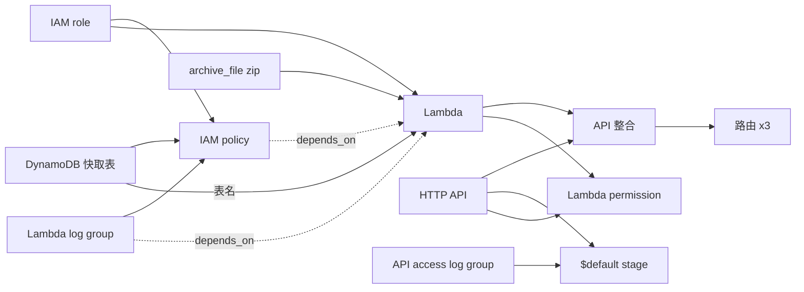

# 基礎設施（Terraform）

所有 AWS 資源都由 Terraform 管理，分成兩個 stack：

| 資料夾 | 內容 | state 放在哪 | 誰執行 |
|---|---|---|---|
| `terraform/bootstrap/` | 存放 state 的 S3 bucket（第八階段會加上 GitHub OIDC 與部署角色） | 本機 local state | 人手動執行一次 |
| `terraform/main/` | API 需要的所有資源 | bootstrap 建立的 S3 bucket | 人或 GitHub Actions |

分兩層的原因：主 stack 的 state 要放在 S3，但那個 bucket 本身也得有人建立。先用 bootstrap 建好 bucket，主 stack 才有地方存 state。

## 主 stack 的資源

| 資源 | 用途 |
|---|---|
| `aws_dynamodb_table.cache` | 天氣快取，Partition Key 是 `city_id`，TTL 屬性是 `expires_at`，On-Demand 計費 |
| `aws_iam_role.lambda` | Lambda 執行角色，只有 Lambda 服務能使用 |
| `aws_iam_role_policy.lambda` | 只允許對快取表做 `GetItem`、`PutItem`、寫入自己的 log group，以及讀取氣象署授權碼這一個 SSM 參數 |
| `aws_cloudwatch_log_group.lambda` | Lambda 的 log，保留 14 天 |
| `data.archive_file.lambda` | 把 `backend/src` 打包成 zip |
| `aws_lambda_function.api` | Python 3.12、arm64，handler 是 `handler.lambda_handler`，環境變數帶入快取設定和授權碼的 SSM 參數名稱（不是授權碼本身） |
| `aws_apigatewayv2_api.http` | HTTP API，CORS 只開放設定的來源 |
| `aws_apigatewayv2_integration.lambda` | Lambda proxy 整合，payload 2.0 |
| `aws_apigatewayv2_route.routes` | `GET /api/health`、`GET /api/cities`、`GET /api/weather`、`GET /api/typhoons`，其他路徑直接 404 |
| `aws_cloudwatch_log_group.api_access` | API Gateway 存取紀錄，保留 14 天 |
| `aws_apigatewayv2_stage.default` | `$default` stage，自動部署，節流每秒 10 次、瞬間 20 次，並寫入存取紀錄 |
| `aws_lambda_permission.apigw` | 允許這個 API 呼叫 Lambda |

## 依賴關係



實線是 Terraform 從屬性引用自動推導出來的順序，虛線是用 `depends_on` 明確指定的順序：Lambda 要等 log group 和權限都建好才能建立，否則第一次執行可能寫不了 log。

## Lambda 程式碼由誰部署

**只由 Terraform 部署。** `archive_file` 打包 `backend/src`，`source_code_hash` 記錄 zip 的 hash，程式碼一改，`plan` 就會顯示 Lambda 要更新。第八階段的 GitHub Actions 也是執行 `terraform apply`，不會用 `aws lambda update-function-code` 直接上傳程式碼。

如果兩邊都能更新程式碼，CI 上傳新版後，Terraform state 裡記的還是舊的 hash，下次 `terraform apply` 就會把程式碼蓋回舊版（State Drift）。只讓一個工具負責，就不會有這個問題。

為了讓 Windows 和 Linux 打包出完全相同的 zip：

- `.gitattributes` 規定所有檔案都用 LF 換行。Windows 預設會把檔案 checkout 成 CRLF，打包出來的 zip 內容會不同。
- `archive_file` 設定 `output_file_mode = "0644"`，統一檔案權限。
- 排除 `__pycache__`，執行過測試也不會讓 zip 改變。

`tests/test_packaging.py` 會檢查 Terraform 的 `handler`、`runtime`、打包路徑和程式碼是否一致，並確認後端沒有 import Lambda 環境裡沒有的套件。

## 檢查指令

```bash
cd terraform/main
terraform fmt -check -recursive ..   # 格式檢查，不會修改檔案
terraform init -backend=false        # 只下載 provider，不連 state（不需要 AWS 帳號）
terraform validate                   # 語法與設定檢查
```

`terraform plan` 需要 AWS 帳號與 state bucket，完整的部署步驟見 [部署手冊](deployment.md)。
